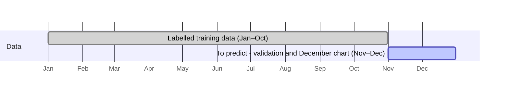
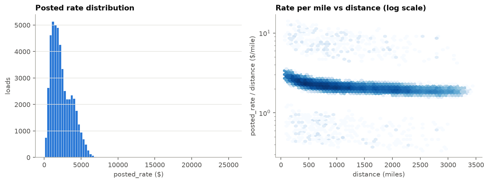
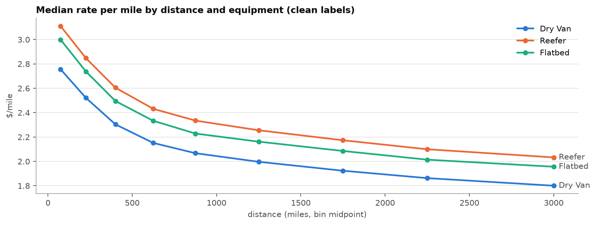
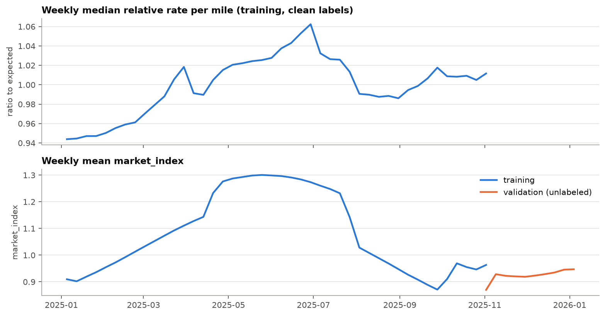
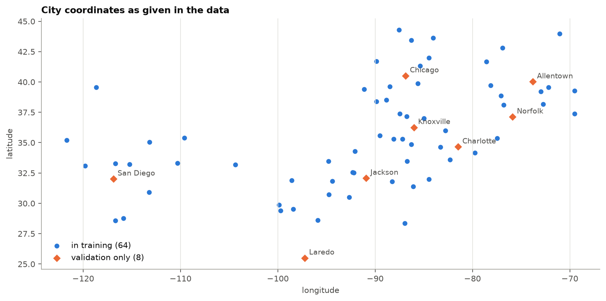
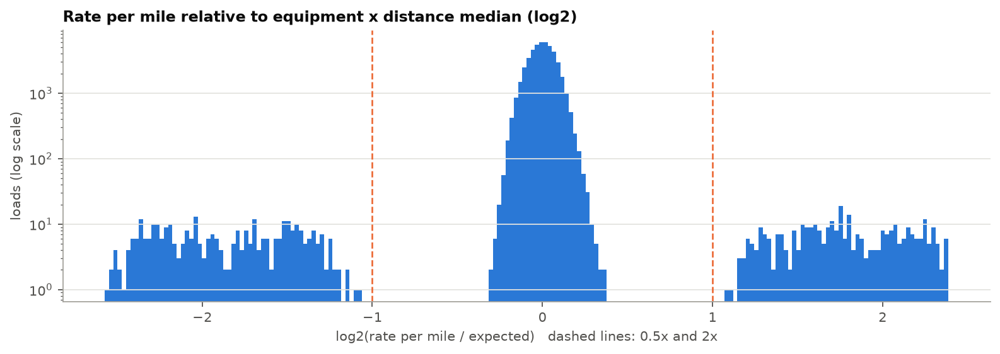
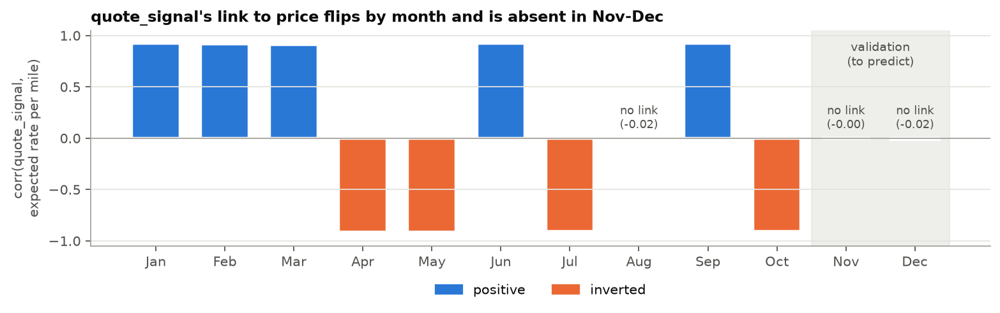
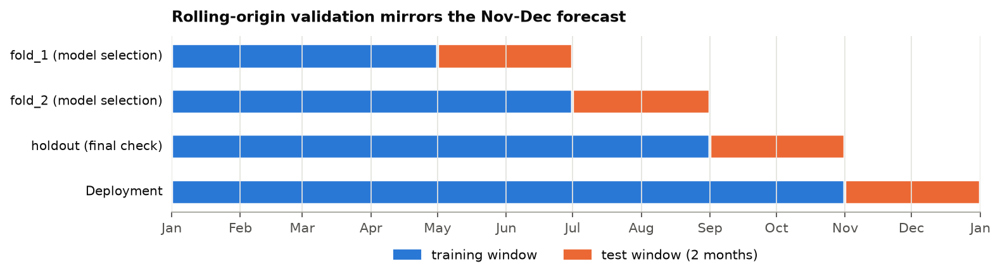
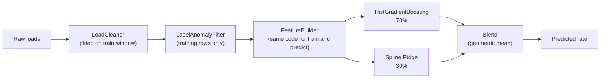
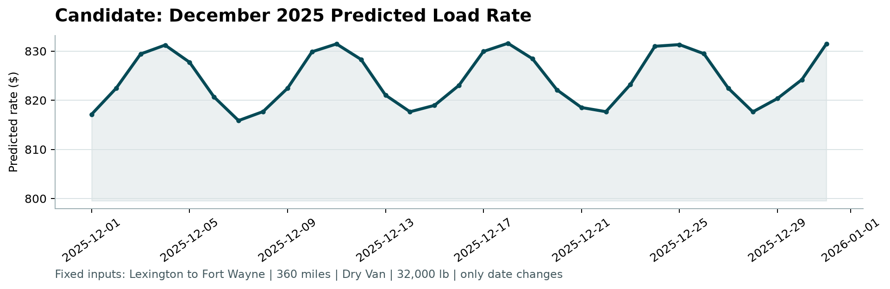

# Freight Rate Prediction


Predicts the posted rate (USD) of a freight load from its lane, distance,
equipment, weight, date and market signals. Built for the Spotter Labs Machine
Learning Engineer assessment.

> **Result:** on a held-back Sep–Oct period that imitates the real Nov–Dec
> forecast, the final model's error is **$65.20 MAE (2.7% MAPE)**. A strong
> equipment × distance baseline scores $79.26 (3.7%).

| Deliverable | File |
|---|---|
| Validation predictions (12,000 loads) | [`validation_predictions.csv`](validation_predictions.csv) |
| Completed December chart inputs (31 days) | [`data/december_chart_inputs.csv`](data/december_chart_inputs.csv) |
| December chart produced by `score.py` | [`scorer_results/candidate_december.png`](scorer_results/candidate_december.png) |
| Report (validation, split approach, chart) | [`reports/Freight_Rate_Prediction_Report.docx`](reports/Freight_Rate_Prediction_Report.docx) |
| Exploratory data analysis | [`notebooks/01_eda.ipynb`](notebooks/01_eda.ipynb) |

---

## Contents

1. [Quick start](#1-quick-start)
2. [The problem](#2-the-problem)
3. [Key findings from the data](#3-key-findings-from-the-data)
4. [Data-quality issues and how they were handled](#4-data-quality-issues-and-how-they-were-handled)
5. [Validation strategy](#5-validation-strategy)
6. [Models used](#6-models-used)
7. [Experiments](#7-experiments)
8. [Why gradient boosting beats the other models](#8-why-gradient-boosting-beats-the-other-models)
9. [Final model and results](#9-final-model-and-results)
10. [Tests](#10-tests)
11. [Repository layout](#11-repository-layout)
12. [Limitations](#12-limitations)
13. [Extra tools (not required by the assessment)](#13-extra-tools-not-required-by-the-assessment)

> Sections marked ▶ are collapsible. Click them to expand the details.

---

## 1. Quick start

Requires Python 3.11+ (developed on Python 3.13.3, Windows).

```bash
python -m venv .venv
# Windows: .venv\Scripts\activate    macOS/Linux: source .venv/bin/activate
python -m pip install -r requirements.txt
python -m pip install -e . --no-deps

python -m freight_rate.pipelines.train     # fit the final model on all labelled data
python -m freight_rate.pipelines.predict   # write validation_predictions.csv and fill the December file
python score.py --predictions validation_predictions.csv \
    --december-predictions data/december_chart_inputs.csv
```

- `requirements.txt` is the single dependency file. It covers the scorer, the
  model, the tests and the notebook.
- The submission was produced with matplotlib 3.11.2, numpy 2.5.4, pandas
  2.3.3 and scikit-learn 1.7.2.
- Runs are deterministic, with a fixed seed of 42. A fresh environment built
  from `requirements.txt` reproduced the committed prediction files byte for
  byte.
- The trained model is saved to `artifacts/model.joblib` and its metadata to
  `artifacts/model.json` (data hash, row counts, library versions).

---

## 2. The problem

| | Training (`train_test.csv`) | Validation (`validation.csv`) |
|---|---|---|
| Rows | 48,000 | 12,000 |
| Dates | 1 Jan – 31 Oct 2025 | 1 Nov – 31 Dec 2025 |
| Target `posted_rate` | given | to predict |
| Cities | 64 | 72 (**8 never seen in training**) |
| Equipment | Dry Van 57% / Reefer 25% / Flatbed 18% | same mix |

Because the validation period lies entirely after the training period, **this
is a forecasting problem, not a random-split regression.** The model has to
predict prices 1–2 months ahead, for some cities it has never seen. Every design
choice below follows from that.



---

## 3. Key findings from the data

All numbers come from cells in [`notebooks/01_eda.ipynb`](notebooks/01_eda.ipynb).

1. **Distance explains most of the price** (correlation 0.91). Rate per mile
   falls with distance, from about $2.8–3.1/mile under 150 miles to
   $1.8–2.0/mile over 2,500 miles.
2. **Equipment shifts the whole curve.** Reefer is the most expensive, then
   Flatbed, then Dry Van, with a roughly constant gap.
3. **`market_index` is a daily, market-wide price level.** It's the next most
   important driver (correlation 0.42 with relative price).
4. **Prices drift upward over time.** At the *same* market_index, rates in
   Sep/Oct are about 6% higher than in January. Recent months therefore
   matter most for Nov–Dec.
5. **Weight has a real but small effect.** The heaviest fifth of loads costs
   about 7% more per mile than the lightest fifth.
6. **City identity matters little** once distance and equipment are known
   (about 1.6% variation). That's good news for the 8 unseen cities.
7. **Day of week has a negligible effect** (within ±1%).

<details>
<summary>▶ Charts from the EDA</summary>

| | |
|---|---|
|  |  |
| Rate grows with distance; rate per mile falls | Equipment shifts the curve in parallel |
|  |  |
| Daily market level and price drift | 8 validation cities are absent from training |

</details>

---

## 4. Data-quality issues and how they were handled

Every fix is **fitted on the training window only**, inside each validation
fold, so no information from test periods leaks in
([`data/cleaning.py`](src/freight_rate/data/cleaning.py)).

| # | Issue | How it was handled |
|---|---|---|
| 1 | **Corrupted price labels.** 677 training rows (1.4%) have a rate per mile 0.2–0.5× or 2–5× the normal level. | **Removed from training, kept in evaluation.** `LabelAnomalyFilter` flags rows whose rate per mile is outside 0.5–2× the median for their equipment and distance band. |
| 2 | **Negative weights** (292 training / 145 validation rows) | Treated as a sign error: **use the absolute value.** |
| 3 | **Missing weight** (0.6% training / 1.4% validation) | Filled with the training median. |
| 4 | **Missing market_index** (0.8% / 2.0%) | Filled with **the same day's average** (market_index barely varies within a day), or the nearest day if a whole day is missing. |
| 5 | **8 unseen cities** (12% of validation loads) | The model uses **coordinates instead of city names**, so it can price a new city from where it is. Measured with a dedicated test (§5). |
| 6 | **December chart file is missing inputs** (no market_index, quote_signal or coordinates) | market_index = that day's average from `validation.csv` (an input, not a label); coordinates come from the city table. |
| 7 | **quote_signal flips meaning by month** | **Excluded from the final model.** See below. |
| 8 | Weight capped at 47,500 lb, 70-mile distance floor, a few long detours on short trips | Checked and found plausible. **Kept as is.** |

<details>
<summary>▶ Evidence: why issue 1 is label corruption, not unusual loads</summary>



- Clean rows sit at 0.81–1.28× the expected rate per mile. Corrupted rows sit
  at 0.17–0.47× or 2.13–5.23×. **No row falls in between**, which is the
  signature of a data error, not of genuinely cheap or expensive loads.
- They occur evenly across months and equipment, and nothing in the inputs
  explains them, so they can't be predicted.
- **Impact:** on the holdout, 1.5% of rows like this produce about 42% of the
  total error of a simple baseline. Results are therefore reported on all rows
  and on clean rows.
- **Why remove instead of using a robust loss:** removing them gave $52.97
  clean MAE. Keeping them gave $80.91, or $57.54 with an absolute-error loss.

</details>

<details>
<summary>▶ Evidence: the quote_signal inversion, and why the feature was dropped</summary>



- **The finding:** pooled over all months, quote_signal looks almost useless
  (correlation 0.07). Within each month, though, it encodes the true rate per
  mile almost exactly (R² ≈ 0.99), and **the sign flips by month**:
  - positive in Jan–Mar, Jun and Sep
  - inverted in Apr–May, Jul and Oct
  - no relationship at all from 2 August onwards
- **What happens in Nov–Dec:** a check that needs no labels (the correlation
  of quote_signal with the price expected from distance and equipment) matches
  the labelled months and is **≈ 0 on every Nov–Dec day**, just like August
  ([`data/quality.py`](src/freight_rate/data/quality.py)).
- **Proof that dropping it helps:**
  - **August lookalike test** (train Jan–Jul, test 2–31 Aug): removing
    quote_signal cut the error from $48.40 to **$42.66 (−12%)**.
  - **Nov–Dec conditions on the selection folds** (quote_signal shuffled in
    the test windows): $65.44 with it, **$55.00** without it.

</details>

---

## 5. Validation strategy

A random K-fold split would let the model train on the future and test on the
past, which gives over-optimistic results. Instead, **rolling-origin
validation** always trains on the past and tests on the next two months, the
same horizon as the real task.



| Fold | Train | Test | Used for |
|---|---|---|---|
| fold_1 | Jan–Apr | May–Jun | choosing the model |
| fold_2 | Jan–Jun | Jul–Aug | choosing the model |
| holdout | Jan–Aug | **Sep–Oct** | a final check, run only after the model was chosen |
| deployment | Jan–Oct | Nov–Dec | the submission |

Additional safeguards:
- **Unseen-city test:** 8 training cities are hidden from the training window.
  The model is scored on test loads that touch exactly one of them, against
  the same loads when the city is visible. This is repeated 3 times.
- **No leakage:** cleaning, anomaly flags and imputation values are re-fitted
  inside every training window. Tests enforce this (§10).
- **Metrics:**
  - **MAE in USD** is the primary metric, on clean rows and on all rows
  - RMSE, MAPE and bias are also reported
  - errors are split by forecast month (month 1 vs month 2)
- Code: [`validation/splits.py`](src/freight_rate/validation/splits.py),
  [`evaluation/cross_validation.py`](src/freight_rate/evaluation/cross_validation.py).

---

## 6. Models used

All learned models predict **log(rate)** and convert back. That makes errors
roughly proportional to the price, and suits the wide range of rates
($60–$7k).



| Model | What it is | Why it was tried |
|---|---|---|
| **Global median** | distance × one median rate per mile | the simplest possible reference |
| **Grouped median** | distance × median rate per mile for each equipment type and distance band | a strong rule-of-thumb baseline that a pricing analyst might use |
| **Spline Ridge** | linear model; a cubic spline on log distance, other features linear | smooth, stable, and continues trends past the training data |
| **HistGradientBoosting (HGB)** | scikit-learn gradient-boosted trees (300 trees, learning rate 0.05, 31 leaves) | learns non-linear effects and interactions automatically |
| **Blend (final)** | 70% HGB + 30% Ridge, weighted geometric mean | combines HGB's accuracy with Ridge's stability further ahead |

**Features used by the final model:**
- log distance
- equipment (one-hot)
- absolute weight
- market_index
- pickup and delivery latitude/longitude

City names, lane IDs, month and quote_signal are deliberately excluded:
- **city names and lane IDs:** they'd fail on the unseen cities
- **month:** Nov–Dec never appear in training
- **quote_signal:** see §4

Both members are trained with **recency weighting**: a load's weight halves
for every 30 days of age.

**First comparison** (mean of the two selection folds, clean rows):

| | Global median | Grouped median | Ridge | **HGB** |
|---|---|---|---|---|
| MAE | $194.49 | $115.87 | $61.52 | **$56.28** |
| MAPE | 9.4% | 5.0% | 2.6% | **2.5%** |
| MAE, first forecast month | $184.65 | $107.19 | $52.52 | **$37.10** |
| MAE, second forecast month | $204.63 | $124.76 | **$70.79** | $76.05 |

---

## 7. Experiments

All experiments use the two selection folds only. The Sep–Oct holdout wasn't
touched until the model was chosen. Full tables are in
[`reports/experiments/`](reports/experiments/).

<details>
<summary>▶ Round 1: handling price drift (trend feature vs recency weighting)</summary>

| HGB variant | Clean MAE |
|---|---|
| no drift handling | $56.28 |
| + time trend feature | $77.19 (worse) |
| + recency weighting, 30-day half-life | **$52.97** |
| + recency weighting, 60 / 120 days | $54.13 / $54.99 |

A trend feature makes things worse: trees can't extrapolate it, and Ridge
over-extrapolates it. **Recency weighting with a 30-day half-life was the
biggest single improvement.**

</details>

<details>
<summary>▶ Round 2: feature ablation (remove one feature at a time)</summary>

| HGB + recency, without… | Clean MAE | Change |
|---|---|---|
| nothing (all features) | $52.97 | — |
| market_index | $70.90 | +$17.93 |
| weight | $68.46 | +$15.49 |
| coordinates | $60.51 | +$7.54 |
| missing-value flags | $53.02 | no change, so removed |
| + day of week | $53.82 | no gain, so not added |

</details>

<details>
<summary>▶ Round 3: tuning and blending</summary>

- **Tuning:** 10 HGB settings (learning rate, trees, leaves, minimum leaf size,
  L2, half-life) all land within ±$1.50 of the defaults. That's within the
  noise, so **the defaults were kept**.
- **Blending:** a 70/30 HGB/Ridge blend gave $51.28 against $53.02 for HGB
  alone. It was clearly better in the second forecast month ($65.54 vs
  $70.62).

</details>

<details>
<summary>▶ Round 6: quote_signal under Nov–Dec conditions</summary>

quote_signal was shuffled within each test window to imitate Nov–Dec, where it
carries no information:

| Model | Clean MAE |
|---|---|
| HGB with quote_signal | $74.97 |
| HGB without quote_signal | $56.80 |
| Blend with quote_signal | $65.44 |
| **Blend without quote_signal (final)** | **$55.00** |

</details>

---

## 8. Why gradient boosting beats the other models

HGB is the most accurate **single** model: $56 clean MAE against $62 for
Ridge and $116 for the best baseline. Four reasons explain this. Reasons 2
and 4 were measured directly; reasons 1 and 3 follow from how the two models
work:

1. **It learns interactions on its own.**
   - Freight prices depend on *combinations*: the distance discount differs by
     equipment, and the effect of a region depends on the direction of travel
     (pickup *and* delivery coordinates together).
   - Ridge adds each feature's effect independently in log space. It can't
     represent "this origin region is expensive only for long hauls" unless
     someone hand-builds that feature.
   - Trees split on combinations naturally.
2. **It uses the coordinates far better.** Removing coordinates costs HGB
   $7.54. Coordinates work as a learned regional map, which a linear model
   can't express with raw latitude/longitude.
3. **It handles non-linear effects without manual work.** The distance curve,
   the weight cap at 47,500 lb and the market_index effect are learned
   directly. Ridge needs a spline just for distance.
4. **It's strongest where most of the signal is: the first forecast month**
   ($37 vs $53 for Ridge).

**Why Ridge is still part of the final model:**
- Trees can't extrapolate. They predict within the range of the training
  prices.
- Prices keep drifting upward, so HGB's error grows faster in the second month
  ($76 vs $71 for Ridge).
- Ridge's smooth, linear market effect holds up better there. Blending 30%
  Ridge reduced the second-month error and gave the best overall score on the
  selection folds.

**An open point on the holdout:** HGB alone scored $63.80 against $65.20 for
the blend. That's a $1.40 difference, within fold-to-fold noise. The blend was
chosen beforehand on the selection folds, and switching after seeing the
holdout would be selecting on the test set. So the decision stands, and the
small difference is reported here.

---

## 9. Final model and results

**Sep–Oct holdout.** The model was trained on Jan–Aug and evaluated once,
after it had been chosen:

| Model | MAE clean | MAE all rows | RMSE clean | MAPE clean | Bias clean |
|---|---|---|---|---|---|
| Grouped median (baseline) | $79.26 | $134.91 | $108.56 | 3.7% | −$15.86 |
| Ridge (no quote_signal) | $76.25 | $131.87 | $126.53 | 3.1% | −$62.25 |
| HGB (no quote_signal) | $63.80 | $119.52 | $92.71 | 2.7% | −$56.60 |
| **Final blend** | **$65.20** | **$120.93** | **$97.13** | **2.7%** | **−$58.47** |

- **Error by month:** $71.98 in September and $58.66 in October.
- **Unseen cities:** about 4% more error than the same loads with the city
  visible ($67.58 vs $64.91 for one of the three hidden-city sets). That's a
  small cost, because coordinates generalise well.
- **All rows vs clean rows:** the roughly $55 gap is the unavoidable cost of
  the ~1.5% corrupted labels in the test data.

**December chart** (Lexington → Fort Wayne, Dry Van, 360 miles, one load per
day):



- Predictions range from $816 to $832. For comparison, recent actual loads on
  this lane, scaled to 360 miles, were $790–841.
- The weekly up-and-down pattern comes from the daily market_index, which
  peaks on Thursdays and dips on Sundays. There's no artificial trend.

---

## 10. Tests

**110 tests**, run with `python -m pytest` (about 20 seconds). Lint:
`python -m ruff check src tests`.

| What the tests protect against | Count | File |
|---|---|---|
| Data leakage and incorrect splits | 15 | `test_cross_validation.py`, `test_splits.py` |
| Wrong data cleaning | 15 | `test_cleaning.py` |
| Training and prediction features drifting apart | 8 | `test_features.py` |
| Model and config errors | 22 | `test_models.py`, `test_config.py` |
| Bad input files | 8 | `test_data_io.py` |
| Invalid submission files, end-to-end run, reproducibility | 21 | `test_inference.py` |
| quote_signal handling | 6 | `test_quality.py` |
| Provided files being modified (`score.py` and 3 data files) | 4 | `test_provided_files.py` |
| EDA and error-analysis helpers | 7 | `test_eda_helpers.py`, `test_error_analysis.py` |
| Report contents (extra tool, §13) | 4 | `test_report.py` |

<details>
<summary>▶ Leakage and split tests</summary>

- `test_model_never_sees_target_or_id`: a spy model records every column it
  receives. The price and load_id must never be among them.
- `test_training_data_precedes_test_window`: every training row is dated
  before the test window.
- `test_final_holdout_untouched_during_selection`: Sep–Oct is never used
  while choosing the model.
- `test_anomalies_dropped_from_training_only`: corrupted labels are removed
  from training but still scored.
- `test_temporal_folds_train_strictly_before_test`,
  `test_temporal_folds_expected_windows`,
  `test_final_holdout_is_the_latest_window`
- `test_city_holdout_removes_hidden_cities_from_training`,
  `test_city_holdout_is_reproducible`
- `test_shuffle_test_permutes_only_named_columns`

</details>

<details>
<summary>▶ Cleaning tests</summary>

- `test_cleaner_state_depends_only_on_fit_data`: fill values come only from
  the training window.
- `test_cleaner_ignores_target`: the cleaner never looks at the price.
- `test_cleaner_never_drops_rows_or_mutates_input`
- `test_weight_abs_and_median_fill`, `test_market_index_same_day_then_nearest_day`,
  `test_market_index_column_absent_is_filled`
- `test_coordinates_filled_from_city_table_when_absent`,
  `test_unknown_city_without_coordinates_raises`
- `test_anomaly_filter_flags_planted_labels_only`: planted bad labels are
  caught, and clean ones aren't.
- `test_anomaly_filter_reference_comes_from_fit_data_only`,
  `test_anomaly_filter_on_real_training_data` (flags 1.2–1.6% of real training rows, in line with the 1.4% found in the EDA)

</details>

<details>
<summary>▶ Feature consistency tests</summary>

- `test_same_columns_for_train_validation_and_december`: all three inputs
  produce identical feature columns with no gaps.
- `test_features_are_row_independent`: a row's features never depend on other
  rows.
- `test_builder_is_stateless_and_ignores_target`
- `test_december_rows_use_fixed_lane_values`, `test_feature_values`,
  rejection of unknown feature groups, unknown equipment and uncleaned data

</details>

<details>
<summary>▶ Model tests</summary>

- `test_configured_models_fit_and_predict`: every model in the config trains.
- `test_models_are_deterministic`: the same seed gives the same predictions.
- `test_recency_weights_halve_every_half_life`
- `test_blend_is_weighted_geometric_mean`
- `test_grouped_median_uses_cell_medians`,
  `test_grouped_median_falls_back_for_unseen_cell`
- `test_final_model_configured_and_trains`,
  `test_final_model_does_not_use_quote_signal`
- config inheritance: `test_extends_merges_params_one_level`,
  `test_circular_extends_rejected`, `test_features_add_and_drop`,
  `test_feature_edits_accumulate_along_extends_chain`

</details>

<details>
<summary>▶ Submission, end-to-end and integrity tests</summary>

- `test_outputs_accepted_by_provided_scorer`: runs train → predict, then the
  real `score.py`, and checks it succeeds.
- `test_submitted_files_are_reproducible`: a fresh run reproduces the
  committed prediction files exactly.
- `test_bad_submissions_rejected` (8 cases): wrong column name or order, a
  missing row, a duplicate or unknown ID, and NaN, infinite or zero rates are
  all rejected, as the scorer would.
- `test_bad_december_rejected` (5 cases): a missing column, a missing day, a
  changed lane or distance, and a negative rate.
- `test_validation_predictions_preserve_template_order`,
  `test_december_file_keeps_original_inputs`
- `test_every_december_date_has_validation_market_data`
- `test_provided_file_unchanged`: SHA-256 checks that `score.py` and the
  provided data files are untouched.

</details>

---

## 11. Repository layout

```
configs/default.yaml        paths, cleaning rules, folds, feature sets, models, final_model
data/                       provided inputs (the December file's predicted_rate is filled)
notebooks/01_eda.ipynb      exploratory analysis, executed with outputs
src/freight_rate/
  data/                     loading, schema checks, leakage-safe cleaning, quote_signal check
  features/build.py         the single feature pipeline (training = prediction)
  validation/splits.py      rolling-origin folds, unseen-city holdout
  evaluation/               metrics, cross-validation harness, error analysis
  models/                   baselines, model registry (built from config)
  inference.py              builds and checks both submission files
  pipelines/                command-line entry points: train, predict, experiment
tests/                      pytest suite
reports/                    report, figures, experiment results
scorer_results/             chart produced by score.py
score.py                    provided scorer (unchanged)
```

The model is defined entirely in [`configs/default.yaml`](configs/default.yaml).
Changing features, parameters or the blend means editing the config, not the
code.

---

## 12. Limitations

- **Forward drift:** every model under-predicts more as the horizon grows. On
  the holdout the bias is about −$58: prices appear to follow market_index
  with a delay. Recency weighting reduces this, but late December may still be
  slightly under-predicted.
- **No seasonality:** one year of data can't show December holiday effects.
- **Corrupted labels in the validation data:** about 1.5% of validation labels
  are probably corrupted too. They can't be predicted and will add roughly $55
  to an all-rows MAE.
- **quote_signal:** if Spotter's Nov–Dec quote_signal did contain a pattern
  that isn't visible without labels, the model doesn't use it. The label-free
  check makes this unlikely.
- **Coordinates are approximate** (about 1° off and sometimes clipped), so
  they work only as a rough regional signal.

---

## 13. Extra tools (not required by the assessment)

These were built for convenience during development. They're not needed to
produce or score the submission.

| Tool | Command | What it does |
|---|---|---|
| Experiment runner | `python -m freight_rate.pipelines.experiment --name <name> --models <models...>` | compares models on the validation folds and writes tables to `reports/experiments/` |
| quote_signal check | `python -m freight_rate.pipelines.quote_signal_check` | the August lookalike test from §4 |
| Notebook re-run | `python -m nbconvert --to notebook --execute --inplace notebooks/01_eda.ipynb` | re-executes the EDA (register the kernel first with `python -m ipykernel install --sys-prefix --name freight-rate`) |

<details>
<summary>▶ Commands that reproduce every experiment table</summary>

```bash
python -m freight_rate.pipelines.experiment --name phase3_baselines \
    --models global_median grouped_median ridge hgb
python -m freight_rate.pipelines.experiment --extra-config configs/experiments/phase4.yaml \
    --name phase4_r4_finalists --models grouped_median hgb hgb_r3 ridge_r3 blend_70
python -m freight_rate.pipelines.experiment --extra-config configs/experiments/phase4.yaml \
    --name phase4_r6_novdec --shuffle-test quote_signal \
    --models grouped_median hgb_r3 hgb_r3_noqs ridge_r3_noqs blend_70 blend_70_noqs final
python -m freight_rate.pipelines.quote_signal_check
# Final holdout: add --include-final (run only after choosing the model)
```

</details>
